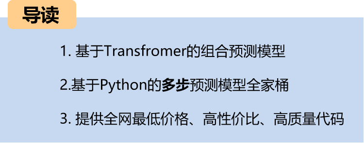
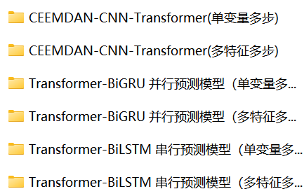
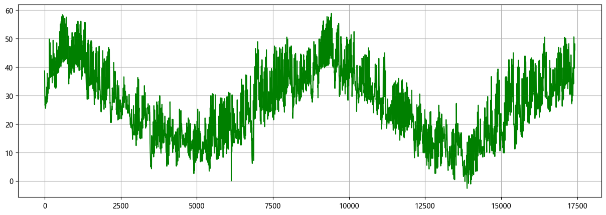
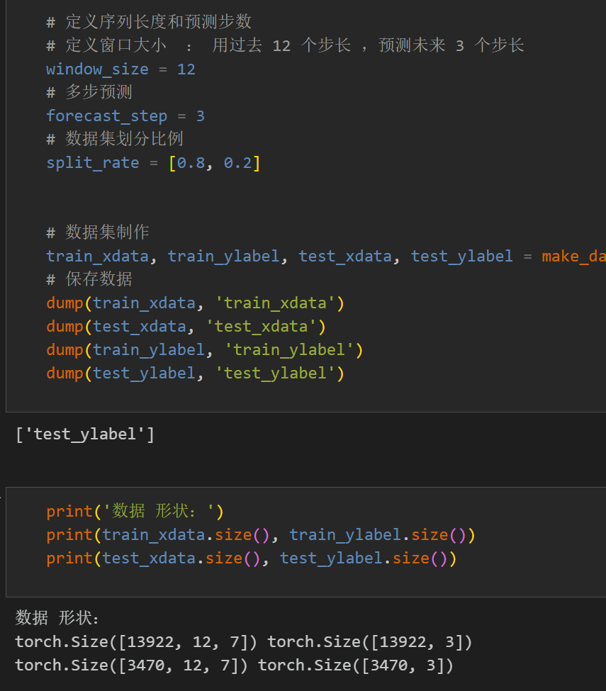
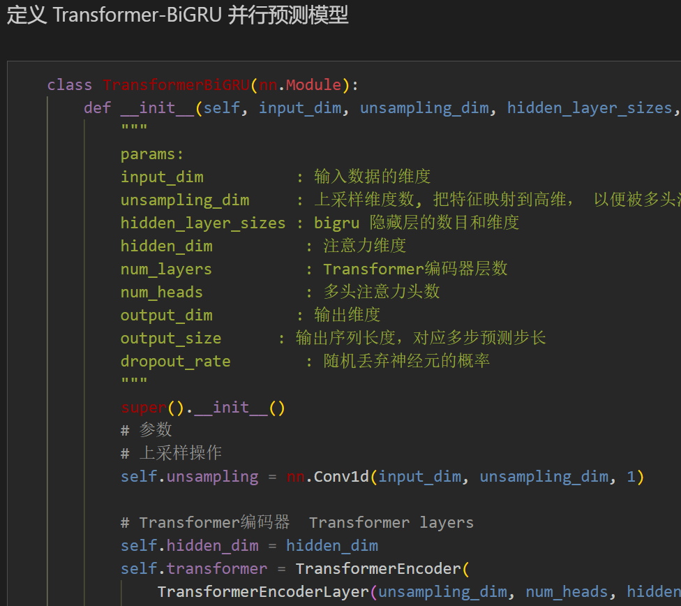
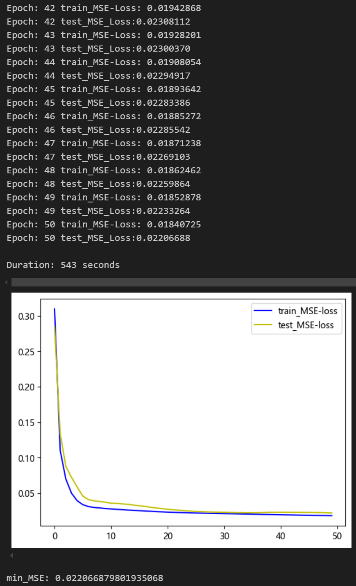
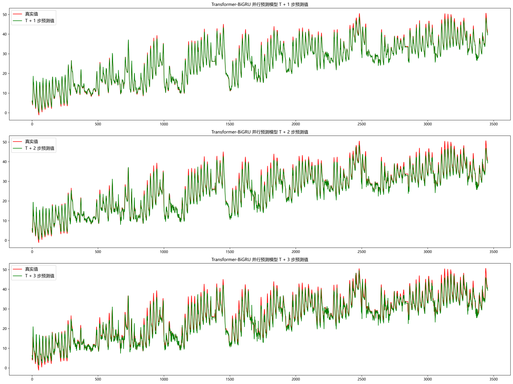
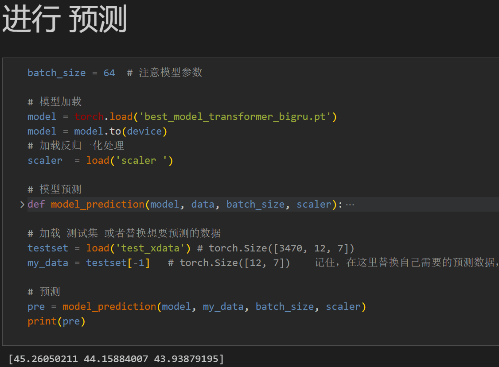
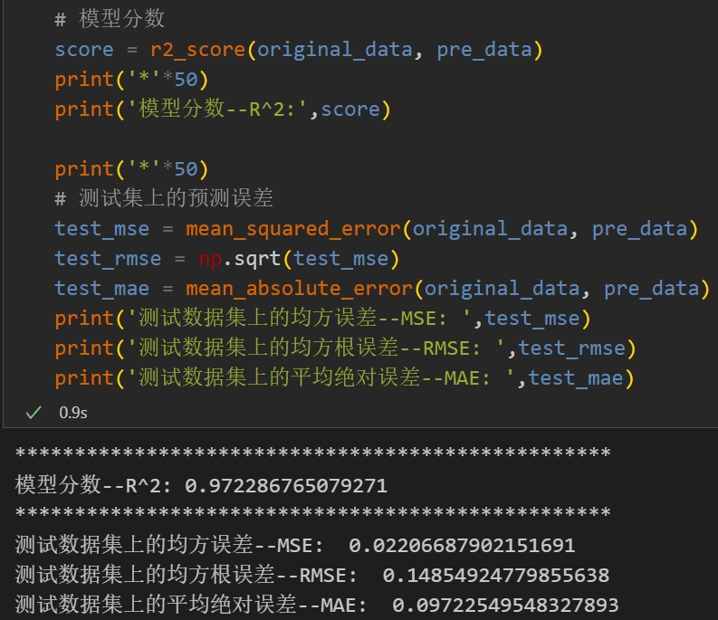

# Multi-step Prediction Update | Compositional Prediction Model Based on Transformer

Environmental Framework: Python 3.9, PyTorch 1.8 and above are compatible for execution.
Supporting Files: Comprehensive tutorial on environment setup and installation, detailed documentation on models and parameters.
Target Audience: Those requiring papers or graduation projects.
Code Guarantees: Code is commented in detail, ready to run without modification.
This issue continues the update of the multi-step prediction family, now including 26 models with exceptionally high cost-performance ratio! This time, we introduce a new combination prediction model for univariate and multi-feature variables: CNN-Transformer, Transformer-BiGRU (parallel), Transformer-BiLSTM (serial).
The complete process includes data code processing:
Multi-step prediction dataset creation, data loading, model definition, parameter setting, model training, model testing, prediction visualization, model evaluation.
Complementary code and file introductions:
Preface
This article introduces a multi-step prediction model based on Transformer-BiGRU parallel network, based on the previous introduction of power transformer (endnote attached to dataset).
Detailed introduction to the power transformer dataset can be found in the following text:
Power Transformer Data Set Introduction and Preprocessing
1 Power Transformer Data Preprocessing and Visualization
1.1 Importing Data
1.2 Multi-step Preprocessing for Power Transformer
2 Transformer-BiGRU Parallel Multi-step Prediction Model
2.1 Define Transformer-BiGRU Parallel Network Model
2.2 Set Parameters and Train the Model
50 epochs, MSE is 0.02207, the Transformer-BiGRU multi-step prediction model has significantly improved prediction performance. The model can fully extract temporal and spatial features from sequences, converges quickly, performs excellently, with high prediction accuracy. By appropriately adjusting model parameters, further improvement in model prediction performance can be achieved.
3 Results Visualization and Prediction, Model Evaluation
3.1 Visualization of Prediction Results
3.2 Load the model for prediction
3.3 Model Evaluation
Click to download: Complete original data, Python code
Previously Featured Content:
Time Series Forecasting: Analysis and comparison of LSTM, ARIMA, Holt-Winters, SARIMA models
Wind Speed Prediction (Part 1) Data Set Introduction and Preprocessing
Wind Speed Prediction (II) EMD-LSTM Model Based on Pytorch
Wind Speed Prediction (III) EMD-LSTM-Attention Model
Wind Speed Prediction (IV) EMD-Transformer Model Based on Pytorch
Wind Speed Prediction (5) EMD-CNN-LSTM Model Based on Pytorch
Wind Speed Prediction (VI) - EMD-CNN-GRU Parallel Model Based on Pytorch
CEEMDAN + Combination Forecasting Model (BiLSTM-Attention + ARIMA)
CEEMDAN + Combination Forecasting Model (CNN-LSTM + ARIMA)
CEEMDAN + Combination Forecasting Model (Transformer - BiLSTM + ARIMA)
CEEMDAN + Combination Forecasting Model (CNN-Transformer + ARIMA)
Multi-feature Variable Sequence Prediction (I) - CNN-LSTM Wind Speed Prediction Model
Multi-feature Variable Sequence Prediction (II) - CNN-LSTM-Attention Wind Speed Prediction Model
Multi-feature Variable Sequence Prediction (III) - CNN-Transformer Wind Speed Prediction Model
Multi-feature Variable Sequence Prediction (IV) - Transformer-BiLSTM Wind Speed Prediction Model
Multi-feature Variable Sequence Prediction (V) CEEMDAN+CNN-LSTM Wind Speed Prediction Model
Multi-feature Variable Sequence Prediction (VI) CEEMDAN+CNN-Transformer Wind Speed Forecasting Model
Biological Optimization Algorithm SSA-based CEEMDAN-BiLSTM-Attention Prediction Model
Biological Optimization Algorithm SSA-based CEEMDAN-Transformer-BiGRU Prediction Model
Superior Prediction Model: Quadratic Decomposition-Combination Prediction
Multi-feature Variable Sequence Prediction (VII) CEEMDAN+Transformer-BiLSTM Prediction Model
Multi-feature Variable Sequence Prediction (VIII) CEEMDAN-SSA-BiLSTM Prediction Model Based on Biological Optimization Algorithm SSA
Multi-feature Variable Sequence Prediction (XI) TCN-GRU Prediction Model Based on Pytorch
VMD + CEEMDAN Quadratic Decomposition, CNN-LSTM Prediction Model
VMD + CEEMDAN Quadratic Decomposition, CNN-Transformer Prediction Model
VMD + CEEMDAN Quadratic Decomposition, Transformer-BiGRU Prediction Model
Prediction Model Based on Biological Optimization Algorithm SSA - Complete Code Kit
Introduction to Electric Power Transformer Data Set and Preprocessing
 | Sci-1 Area High Innovation Prediction Model!
END

## Images

<!-- PAYMENT_BLOCK -->

## Get this dataset

- Payment link (Stripe): [Buy now](https://buy.stripe.com/3cs8yP7sY87d0vu9AB)
- Payment QR code: 

<!-- /PAYMENT_BLOCK -->
